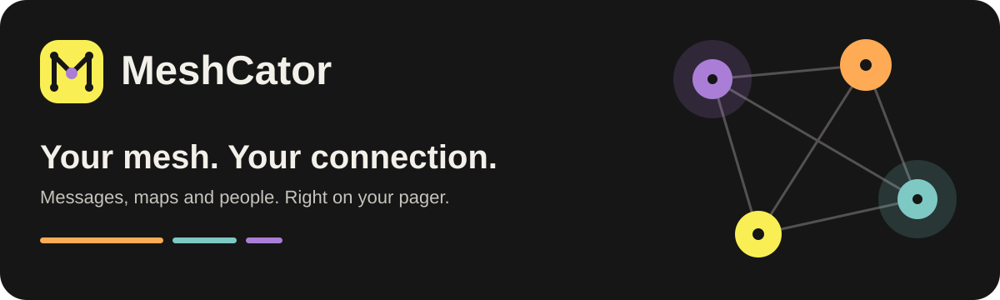
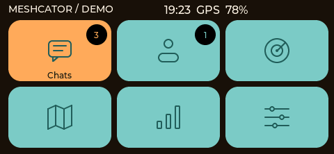
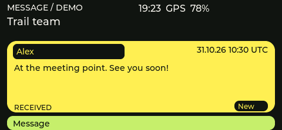
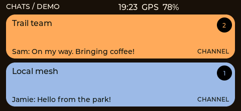
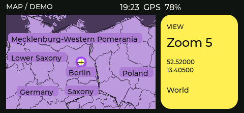
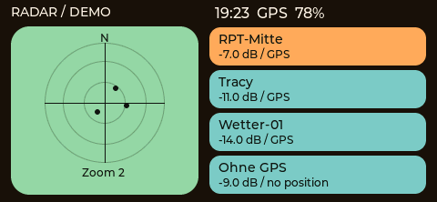
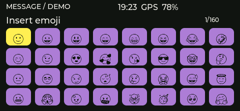

  

  <strong>A colorful, hands-on MeshCore experience for the LilyGO T-LoRa Pager.</strong> 
  Stay in touch, explore your surroundings and keep your mesh close.

  <a href="#a-look-around">Take a look</a> ·
  <a href="#made-for-the-pager">How it feels</a> ·
  <a href="#try-meshcator">Try MeshCator</a> ·
  <a href="https://github.com/MrNash23/MeshCoder/issues">Share feedback</a>

## Your conversations, wherever you go

MeshCator turns your pager into a pocket companion for **MeshCore messaging and offline maps**. Send direct messages, join group channels and see contacts with shared locations on the map. Messages travel over the mesh without requiring mobile data or an internet connection, as long as a radio path is available.

Big rounded tiles, clear colors and physical controls keep the experience simple. Choose a look you like, turn the wheel and get going.

## A look around

<table>
  <tr>
    <td width="50%"> <strong>Everything within reach</strong> Messages, contacts, maps and settings, with unread badges at a glance.</td>
    <td width="50%"> <strong>Pick up where you left off</strong> Open a conversation at its oldest unread message. Sender, time and message are easy to tell apart.</td>
  </tr>
  <tr>
    <td> <strong>Your people, your channels</strong> Keep direct messages and group channels together, or filter the list. Create private channels with your own key.</td>
    <td> <strong>A map that comes with you</strong> Explore the built-in overview map, or add more detailed offline maps on an SD card.</td>
  </tr>
  <tr>
    <td> <strong>Find your bearings</strong> See contacts with known locations, save places and follow a bearing toward a saved destination.</td>
    <td> <strong>A little more expression</strong> Send familiar emojis and see supported emoji characters in messages and contact names.</td>
  </tr>
</table>

*Screenshots show the current interface in the desktop simulator, using fictional demo data. They are not live network activity.*

## Made for the pager

| What you want to do | What to press |
| --- | --- |
| Choose an item | Turn the wheel |
| Open or confirm | Click the wheel or press Enter |
| Open the main menu | Hold the wheel button |
| Browse a conversation | Turn the wheel |
| Send your message | Press Enter |
| Delete a character while typing | Tap Back/Del |
| Go back from a conversation | Hold Back/Del for about 0.8 seconds |
| Move around the map | **A** left · **S** right · **W** up · **Z** down |
| Zoom the map | Turn the wheel |

A short introduction explains the controls on first start. You can revisit it in Help. Haptic feedback gives menu selections and confirmations a physical click.

## Make it yours

- **Choose your style.** Switch between colorful themes, including warm orange and purple.
- **Choose your language.** English, French, Spanish or German. English is the default.
- **Choose your alerts.** Sound, vibration, both or silence — globally or for individual conversations. Display wake-up is a separate choice.
- **Keep your conversations.** Up to 512 messages are kept on the device. An SD card can also keep an additional message log.
- **Explore offline.** Use full-screen maps, show or hide contacts, and save your current location when GPS is available. Navigation provides direction and distance, rather than turn-by-turn road instructions.
- **Connect your phone.** Use the MeshCore companion app over Bluetooth when you want a larger screen.

## Try MeshCator

MeshCator is being developed and tested on the **LilyGO T-LoRa Pager SX1262**. The current version is **0.3.25**, and the project is still under active development.

Curious to try it? Start with the [setup and development guide](docs/DEVELOPMENT.md). Installation currently needs some hands-on setup; a universal one-click installer is not available yet. You can also explore the desktop demo before using a pager.

Found something confusing, missing or broken? [Tell us about it](https://github.com/MrNash23/MeshCoder/issues). Real-world feedback helps shape the next version.

## Built on a shared effort

MeshCator builds on MeshCore and the work of the LilyGO, LVGL, font, emoji and open-map communities. Credits are available inside the app, with the full [acknowledgements and licenses here](THIRD_PARTY.md).

MeshCator's own code is available under the [MIT license](LICENSE). Included libraries and assets retain their own licenses.

Looking for the technical documentation?

[Setup & development](docs/DEVELOPMENT.md) · [Detailed features](docs/FEATURES-0.3.md) · [Offline maps](docs/MAPS.md) · [Message storage](docs/HISTORY-0.3.8.md) · [License inventory](LICENSES/components.json)

The development reference includes historical notes and is currently mostly in German.

